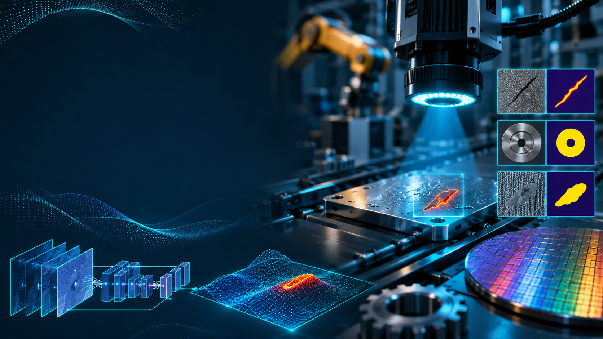

# 🔬 Awesome Machine Vision & Anomaly Detection

**A curated research library for industrial inspection, defect segmentation, and visual anomaly detection**

**[📚 Browse Papers](#-explore-the-library) · [🧭 Start Here](#-where-should-i-start) · [📈 Research Trends](#-research-landscape) · [🤝 Contribute](#-contributing)**

 

---

## 🎯 About this collection

An organized reading list covering **industrial anomaly detection**, **defect classification, detection and segmentation**, and **label-efficient visual learning**. The catalog includes recent and foundational work, with links to papers and code when identified.

> **Metadata note:** This is a community research index, not a verified leaderboard. Some recent entries link to Google Scholar title searches rather than publisher pages, and some venue/year claims still require primary-source verification. **“Code not verified” does not mean code is unavailable.**

## 📚 Explore the library

<!-- PAPER_COUNT_AUTO --> **Total papers: 186** (automatically counted from the three catalogs).

| Research track | Papers listed | Explore |
|:--|--:|:--|
| **Industrial Anomaly Detection** | 133 | [Browse papers](catalog/industrial-anomaly-detection.md) |
| **Classification, Detection & Segmentation** | 29 | [Browse papers](catalog/classification-detection-and-segmentation.md) |
| **Semi-supervised & Weakly-supervised Learning** | 24 | [Browse papers](catalog/semi-supervised-and-weakly-supervised-learning.md) |

### 🧭 Research topics

`Unsupervised AD` · `Zero-shot / Few-shot` · `Vision-Language Models` · `Foundation Models` · `3D / Multimodal` · `Defect Segmentation` · `Anomaly Synthesis` · `Semi-supervised Learning` · `Weak Supervision`

*Topic tags above are a reading guide, not yet a verified per-paper classification. A searchable, tagged index is a recommended next improvement.*

## 🧠 Where should I start?

| Your research question | Suggested starting point |
|:--|:--|
| How can I detect defects without labeled anomalies? | [Industrial anomaly detection](catalog/industrial-anomaly-detection.md) — reconstruction, feature matching, normality modeling |
| How can I detect previously unseen defects? | [Industrial anomaly detection](catalog/industrial-anomaly-detection.md) — zero-shot and vision-language methods |
| How do I localize defects at pixel level? | [Classification, detection & segmentation](catalog/classification-detection-and-segmentation.md) |
| What if I have very few pixel annotations? | [Semi-/weakly supervised learning](catalog/semi-supervised-and-weakly-supervised-learning.md) |
| How can I inspect geometry, depth or multiple sensors? | [Industrial anomaly detection](catalog/industrial-anomaly-detection.md) — 3D and multimodal papers |

## 📈 Research landscape

The collection reflects several research directions worth following:

1. **Foundation-model adaptation:** Reusing pretrained vision and vision-language representations for defect localization.
2. **Label-efficient learning:** Few-shot, semi-supervised and weakly supervised approaches to reduce annotation burden.
3. **Beyond RGB:** Depth, point clouds, multi-view imaging, and cross-modal fusion.
4. **Synthetic defects:** Diffusion and other generation strategies for scarce anomaly examples.
5. **Generalist inspection:** Unified models across categories, tasks, and industrial domains.

These are qualitative research themes, **not** measured trends or performance rankings.

## 🔎 Featured reading

A short selection of papers with direct paper links and linked implementation repositories in the supplied catalog:

| Paper | Venue / year as listed | Code |
|:--|:--|:--|
| [AnomalyCLIP: Object-agnostic Prompt Learning for Zero-shot Anomaly Detection](https://openreview.net/pdf?id=buC4E91xZE) | ICLR 2024 | [Code](https://github.com/zqhang/AnomalyCLIP) |
| [AA-CLIP: Enhancing Zero-Shot Anomaly Detection via Anomaly-Aware CLIP](https://openaccess.thecvf.com/content/CVPR2025/html/Ma_AA-CLIP_Enhancing_Zero-Shot_Anomaly_Detection_via_Anomaly-Aware_CLIP_CVPR_2025_paper.html) | CVPR 2025 | [Code](https://github.com/Mwxinnn/AA-CLIP) |
| [ReMP-AD: Retrieval-enhanced Multi-modal Prompt Fusion](https://openaccess.thecvf.com/content/ICCV2025/html/Ma_ReMP-AD_Retrieval-enhanced_Multi-modal_Prompt_Fusion_for_Few-Shot_Industrial_Visual_Anomaly_ICCV_2025_paper.html) | ICCV 2025 | [Code](https://github.com/cshcma/ReMP-AD) |
| [AnomalyGPT: Detecting Industrial Anomalies Using Large Vision-Language Models](https://arxiv.org/abs/2308.15366) | AAAI 2023 | [Code](https://github.com/CASIA-IVA-Lab/AnomalyGPT) |
| [Uncertainty-aware and dynamically-mixed pseudo-labels for semi-supervised defect segmentation](https://www.sciencedirect.com/science/article/abs/pii/S0166361523001458) | Computers in Industry 2023 | [Code](https://github.com/djene-mengistu/UAPS) |

*Featured links are drawn from the supplied list; this is not a performance-based ranking or an independent link audit.*

## 🤝 Contributing — Suggest a Paper

**Found a relevant paper missing from the collection?** You can suggest it in a minute, without editing Markdown or requesting repository access.

**How it works:**

1. Click **Submit a Paper** and sign in to GitHub if prompted.
2. Fill in the title, paper link, year, research category, and optional code link.
3. Submit the issue. A maintainer reviews the metadata, checks for duplicates, and decides whether to add the paper.

**Other ways to help:** [Report a broken link or correction](https://github.com/djene-mengistu/Awesome-Machine-Vision-and-Anomaly-Detection/issues/new), or open a pull request with a proposed catalog edit.

For new papers, please include:

- **Title, authors, year, and verified venue** (or label it clearly as a preprint)
- **Canonical paper link** (publisher, proceedings, DOI, or arXiv)
- **Official code link**, when confirmed; otherwise mark **Code not verified**
- **Research track** and, ideally, learning setting (unsupervised, zero-shot, few-shot, supervised, etc.)

Please avoid duplicate entries, speculative venue assignments, and unsupported state-of-the-art claims. **Submissions are reviewed; they are not automatically published.**

> The submission button works after `.github/ISSUE_TEMPLATE/submit-paper.yml` is added to the repository and GitHub Issues is enabled.

## 📬 Contact

Maintained by [Dejene M. Sime](https://github.com/djene-mengistu). For suggestions and corrections, please use [GitHub Issues](https://github.com/djene-mengistu/Awesome-Machine-Vision-and-Anomaly-Detection/issues).

**Found this useful? ⭐ Star the repository and share it with your research group.**

[⬆ Back to top](#-awesome-machine-vision--anomaly-detection)

